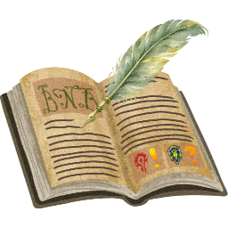

  
    
  <h1>BigNoteBox</h1>
  <b>By Dukul</b>
    
  

# ℹ️ About

BigNoteBox is a full in-game notepad companion for World of Warcraft.

Create, organize, and manage unlimited notes directly inside the game. Notes are stored account-wide with optional per-character scope, allowing both global planning and character-specific tracking.

It has folders, a search that finds any note from anywhere, sticky notes, notes that show up in the right place, tasks, alarms, rich formatting, history, backups, sharing and much more.

---

## ⬇️ Downloads

You can download BigNoteBox from the official sources below:

- <a href="https://addons.wago.io/addons/bignotebox" target="_blank">Wago</a>
- <a href="https://www.curseforge.com/wow/addons/bignotebox" target="_blank">CurseForge</a>
- <a href="https://www.wowinterface.com/downloads/info27121-BigNoteBox.html" target="_blank">WoWInterface</a>

## ⚠️ Warning

BigNoteBox is only distributed through the official links above.

If you download it from any other website, it is **not official, not maintained, and may be modified or unsafe**.

---

# 🌍 Runs on

Retail and WoW: Forever, and in beta on Classic Era, TBC Anniversary and Mists of Pandaria Classic. One download for every client.

---

# 📓 Notes & Folders

- As many notes as you like, each with a title and as much text as you want
- Global or per-character scope per note
- Folders: drag notes in, give a folder a color; deleting a folder never deletes its notes
- Pin notes to the top, mark favorites, lock a note against edits
- Sort by creation date, last modified, title or your own drag order
- Duplicate, copy or move notes, alone or several at once in Select mode

---

# 🗂️ Note List & Explorer View

Two ways to see your notes: the Note list beside the open note, or the Explorer view, a grid of icons over the whole window like the file explorer on your computer.

- Pinned, Folders and Notes sections that remember if they are open
- Pick several notes and drag them onto a folder
- Pinned first or Favorites first from the View menu
- Filter by tags, or to notes with tasks

---

# 🔮 Oracle Search

A search bar that finds any note from anywhere in the game, by title, text or tag. Ctrl+Space or `/bnb search`.

- Enter opens the note; Shift as a sticky note, Ctrl in Focus mode, Alt in the Reference Box
- Prefixes narrow it down: player and NPC notes, items, zones, tasks, alarms, this character, today / this week
- Search the Trash or the settings, send a note to chat
- `#tag`, `@who`, `*` favorites, `-word` to leave a word out, `"an exact phrase"`

---

# 🏷️ Tags

- As many tags as you like on a note, the same whatever their case
- Click a tag to show only its notes; the tag tree groups every note by tag
- The Tag Manager renames, colors and deletes tags across all your notes

---

# ✍️ Writing, Templates & Tokens

- Notes save as you type (or with a Save button)
- Undo and redo per note, kept between sessions if you like
- Links to other notes, waypoint links, and links to a Settings page or help topic
- Templates: Blank, Boss, Weekly, Journal, or save any note as your own; share them as a code
- Note tokens fill themselves in: `{{date}}`, `{{zone}}`, `{{target}}`, `{{coords}}`, `{{ilvl}}`, `{{item:6948}}` and your own
- Each note has its own icon, icon frame, border, background and font

---

# 📔 Rich Notes

A rich note is a small page, with a live preview beside the text. The tags are compatible with Total RP 3.

- Headings and paragraphs, left, centered or right
- Colored text with a color picker
- Game icons, game art (atlas) and your own pictures
- Clickable links; item and spell links show their tooltips
- Shows as a page on sticky notes too

---

# ⚡ Quick Notes & Note Capture

- F7 makes a new note at once, in the main window or as a sticky note
- Quest, gossip, book and letter windows get a note button: one click keeps their text
- Dialogue UI and Immersion get the same button

---

# 🎯 Focus Mode

- Write in full screen with the game interface hidden
- The camera slowly circles your character (or not)
- A rich note gets its preview beside the text
- Esc brings everything back as it was

---

# 📌 Sticky Notes

- Pin any note to your screen; up to 50 at once (20 by default)
- Each sticky has its own font, size, color, background and border
- A note with tasks can show its tasks, ticked right on the sticky
- Stickies can stay on the Esc menu screen instead of the game screen
- Ctrl+H shows or hides every sticky, Ctrl+J brings them to the front

---

# 🔔 Situations & Toasts

A note shows up by itself where it matters, as a toast or a sticky note.

- A zone, sub-zone, instance or instance type (dungeon, raid, delve, battleground)
- A player, an NPC or a guild
- A window: vendor, bank, mailbox, auction house or trainer
- Being rested, in an inn or in a city
- When it starts, ends or both; every time, once a session, a day, a reset or only once
- A situation can place waypoints
- Toasts: choose which show, where, how they look and how long they stay

---

# ✅ Tasks

- Checklists with sub-tasks inside any note
- Untick themselves at the daily or weekly reset, the whole list or one task at a time
- Tick them on a sticky note
- One button shows only notes with tasks

---

# ⏰ Alarms

- Ring at a real-world time, an in-game time, or the daily or weekly reset
- Once, or on the days you choose
- The note pops up with a sound; snooze or dismiss
- The alarm list shows every alarm

---

# 🗃️ Reference Box

- Items, spells, quests and links attached to a note, beside the editor
- Drag them in, or Shift-click a link while it is open
- A note about a player keeps their gear, with a model viewer and a transmog view
- Ctrl-click a gear card to open the dressing room

---

# 👤 Player & NPC Notes

- A note about a player from the Inspect window or their right-click menu, about an NPC with F6
- Portrait and details filled in, a player's gear in the Reference Box
- tl;dr: one short line (like KOS) that shows in their tooltip

---

# 🕰️ History, Undo & 🗑️ Trash

History and kept undo live in the `BigNoteBox_History` addon, which comes with BigNoteBox.

- A version of each note is saved when you log out or reload
- Compare two versions side by side and bring an old one back
- Restore points by hand before a big change
- Rescue a note that went missing without being deleted
- Deleted notes wait in the Trash for 30 days (you choose how long)

---

# 💾 Backup, Import & 🔄 Migration

- Full backup: notes, templates, tokens, tag colors and every settings profile, as JSON
- Settings backup, and a Selective backup in JSON or Markdown
- Import takes backups, shared notes, template codes and profile codes
- Export a note as HTML in three styles
- Move your notes over from OneWoW Notes, Noteworthy II, Take A Note, Yet Another Notepad, Notepad, Notes, TinyPad, PurpleNotes, SimpleNote, Quick Notes, MyNotepad and AmmeNotepad: see them before they come in, nothing is removed from the other addon

---

# 🤝 Sharing

- Share a note with what goes with it: tags, tasks, Reference Box, look, situation, player or NPC data
- Send it straight to another BigNoteBox user, or as a share code
- Send to Chat posts the note's text in a chat channel, line by line

---

# 🔗 BigChatBox

BigNoteBox works on its own. With BigChatBox installed you can also send a note to chat through it and capture chat into a note.

---

# 🎨 Look & Feel

- Blizzard's own window look by default, or Skin mode in 14 colors (OLED and OLED Flat among them) with a brightness slider
- Bundled fonts, OpenDyslexic among them, plus every LibSharedMedia font you have
- Accessibility: turn off or slow down the sticky note animation

---

# 🧩 Modules & Profiles

- Switch whole parts on or off; Minimal, Full and Custom switch many at once
- Your notes keep everything, so switching a module back on brings it all back
- Settings profiles per character, shared as a code

---

# ❓ Help, ⌨️ Keys & Commands

The help book has every help topic in chapters, with a search: the Help button at the top of the main window, or `/bnb help`.

| Key | Does |
|---|---|
| Ctrl+N | Open or close BigNoteBox |
| F8 / F7 / F6 | New note / quick note / note from your target |
| Ctrl+Space | Oracle search |
| Ctrl+H / Ctrl+J | Hide or show stickies / stickies to the front |

Commands: `/bnb`, `/bnb new`, `/bnb search <text>`, `/bnb config`, `/bnb whatsnew`, `/bnb features`, `/bnb help`, `/bnb commands`.

---

# 🚨 Danger Zone

Reset the profile in use or every setting, clear the trash or the history, reset sticky layouts, delete all notes, factory reset, re-run the setup wizard. Take a backup first.

---

# 🛠️ Developer Tools

Working on BigNoteBox itself? The developer tools are a separate addon, `BigNoteBox_Dev`, downloadable from each GitHub release. You do not need it to use BigNoteBox. See [DEVTOOL.md](DEVTOOL.md).

---

# 📜 License

The code is licensed under the [GNU General Public License v3](LICENSE). The BigNoteBox and BigChatBox logos and the addon icon are All Rights Reserved, and the rest of the art is World of Warcraft art belonging to Blizzard Entertainment: see [LICENSE-ASSETS](LICENSE-ASSETS). Bundled libraries and fonts keep their own licenses. Releases up to v1.22.x were MIT licensed.
